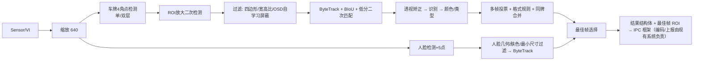
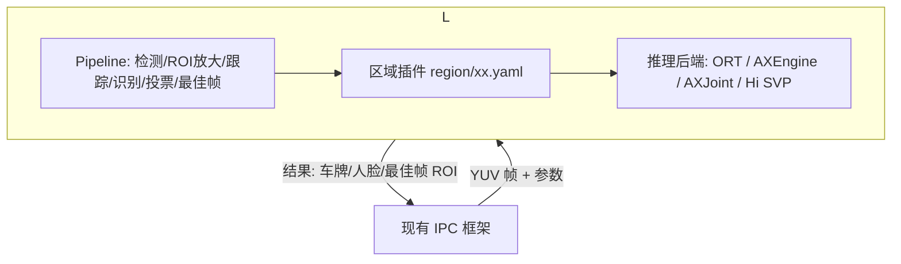

# 海外车牌检测识别 + 人脸检测（车载 IPC）方案与工作清单（v1.0 定稿）

> 日期：2026-10-12 ｜ 状态：**v1.0 已批准**（2026-10-12），未建 GitHub 项目
> 标注约定：**[估]** = 经验估计；**[待核实]** = 公开资料不足，需要原厂或实测确认；其余结论附来源链接。

---

## 0. 结论摘要
| 项 | 结论（v1.0） |
|---|---|
| 芯片优先级 | **AX631 > AX630C > AX620Q > Hi3516DV500 > AX620A**。前三颗同属 Pulsar2/`.axmodel`，一套模型；海思由你方内网编译链编译，我方交付 ONNX + 转换脚本；AX620A 最后做降配版 |
| 交付形态 | **算法包**（与旧旷视算法包同构：`algo.yaml` + `algo.json` + models + libs，见 §5、附录 A）+ C API：输入 YUV 帧 + 参数，每帧输出检测/识别结果（分数、车牌四角点、人脸框+关键点、最佳帧标志与参数），**由框架抠图**；支持零拷贝 YUV；上报协议、主机端均不在范围内 |
| 识别方案 | 检测 → 矫正 → 固定长度多头识别（fast-plate-ocr 式，MIT），按区域插件管理字符表与格式规则；P0 用 fast-plate-ocr 全球预训练权重起步，后续用你方数据微调 |
| 区域顺序 | P1：**EU + UK + 巴西**；P2（实际项目）：**新加坡（第一个）**→ 墨西哥、塞尔维亚、南非 |
| 指标 | ≥15 fps，检出率 ≥95%，整牌识别准确率 ≥98%，误报 <0.5 次/小时，相对车速 ≤60 km/h，**识别距离 ≤10 m**（OS04A10 + 4/8/12/25 mm，见 §2.1；4 mm 在 10 m 处牌宽约 72 px，属临界） |
| 一期范围 | 只输出车牌文本（+国家）；颜色/类型/特殊符号（轮椅、绿叶等）为二期，输出结构预留字段 |
| 人脸 | IPC 只做检测 + 跟踪 + 最佳帧抓拍，识别在 MDVR 主机 |
| 授权 | **禁止任何 AGPL/GPL 组件**（含 Ultralytics YOLO、OpenALPR、yolov5-face） |
| 总工作量 | 约 **172～244 人日 [估]**（我方，含 4 个 P2 国家），不含采集、标注、路测 |

---

## 1. 沿用上一项目的架构（ax630c-plate-face-demo v2.3）

v2.x 的经验直接沿用到新框架：
- **快速运动跟踪**：BIoU 扩框 0.4、IoU 不乘检测分、低分框二次匹配（车载扫街场景最关键）。
- **OSD**：自学习屏蔽区，3000 帧过期，另提供 `osd_mask` 配置，不写死区域。
- **广告牌/招牌**：以几何特征为主、格式规则为辅，再加时序投票 → 海外版的格式规则改为**区域插件**提供。
- **人脸误检（轮胎）**：五点几何、肤色比例、最小尺寸、至少 3 帧命中。
- **量化**：识别模型 INT8 余弦相似度只有 0.875，改用 U16 → 海外识别模型（尤其 Transformer/CCT 类）**默认按 U16/混合精度规划**。
- **授权**：yolov5-face 是 GPL-3.0，WIDER FACE 授权说法不一，SCRFD 仅限非商用 → 海外量产必须换成可商用的人脸模型。

---

## 2. 芯片对比
| 芯片 | NPU | CPU | 内存 | 工具链 / 模型格式 | 来源 |
|---|---|---|---|---|---|
| **AX631**（优先级 1）| 4.0 TOPS INT8 / 16 TOPS INT4，混合精度，Neutron 4.0 | 双核 A53 @1.5GHz | 外置；ISP 4K@40fps，JPEG 4K@40fps | **Pulsar2**（快速入门列为与 AX630C 同一流程），`.axmodel` + AXEngine；npu_mode 支持情况 **[待核实]** | [官网](https://axera-tech.com/zh-hans/product/3211.html)，[Pulsar2 AX620E 快速入门](https://pulsar2-docs.readthedocs.io/en/latest/user_guides_quick/quick_start_ax620e.html) |
| Hi3516DV500 | 2 TOPS INT8 | 双核 A55 @850MHz | 外置 DDR4/LPDDR4(x)，容量随板子定 | 海思 SVP NN 推理（SDK 中常称 **SVP ACL / ATC 转 `.om` 模型**）**[待核实：具体名称、算子表、是否支持 INT16 混合精度，以原厂 SDK 文档为准]**；**你方内网已有编译链**：我方交付 ONNX + 量化校准集 + 转换脚本模板，你方编译并回传精度/耗时 | [海思官网](https://www.hisilicon.com/cn/products/smart-vision/pro-camera/Hi3516DV500)，[海图开发板](http://haitutech.cn/proinfo/30.html) |
| AX620A | 标称 3.6 TOPS INT8 是芯片总算力，与 AI-ISP 平分后**应用实际约 1.8T** | 四核 A7 @1GHz（32 位） | 外置 | **老 Pulsar**，输出 `.joint` 模型；Pulsar2 **不支持** | [Pulsar 文档](https://pulsar-docs.readthedocs.io/en/latest/pulsar/introduction.html)，[neucrack 实测](https://neucrack.com/p/440) |
| AX630C | 3.2 TOPS INT8，支持 ViT/Swin/DETR 类 Transformer | 双核 A53 @1.2G | 外置 | **Pulsar2**，输出 `.axmodel`，用 AXEngine 运行 | [爱芯新闻稿](https://www.axera-tech.com/en/news/2792.html)，[Pulsar2 AX620E 快速入门](https://pulsar2-docs.readthedocs.io/en/latest/user_guides_quick/quick_start_ax620e.html) |
| AX620Q | 2.0 TOPS INT8 | 与 AX630C 同属 AX620E 系列 **[待核实 CPU 规格]** | **内置 256MB LPDDR4** | Pulsar2 / `.axmodel`（与 AX630C 二进制相同） | 同上 |

**对可移植框架的影响**
- 推理后端抽象 `IInferBackend { load / input_info / run / output }`，实现四种：`OrtBackend`（x86 开发和回归）、`AxEngineBackend`（AX631/AX630C/AX620Q）、`AxJointBackend`（AX620A，可选）、`HiSvpBackend`（Hi3516DV500）。
- 前后处理全部放在 C++ 公共层，并且**只依赖 NCHW/NHWC + 量化参数**；每个芯片单独维护一份模型「导出配方」（ONNX opset、输入布局、量化精度、校准集）。
- 模型设计按**最弱后端的算子集**约束：只用 Conv/BN/ReLU(6)/Concat/Resize/简单 MatMul，避免 GELU、LayerNorm、动态 shape；Transformer 类识别器先在 Hi3516DV500 上验证能否转换 **[待核实]**。
- 前处理优先用芯片硬件（AX IVPS / 海思 VPSS）做缩放和裁剪，CPU 只做透视变换（小图）。

**单帧预算 [估]**（按 v2.3 在 AX630C 上的数据外推，未实测）
| 模块 | AX630C（AX631 约 ×0.8 [估]）| AX620Q | Hi3516DV500 |
|---|---|---|---|
| 车牌检测 640×384 | ~8–12 ms（ROI 二检约 +18%） | ×1.4–1.6 | ×1.5–2 **[待核实]** |
| 人脸检测 640 | ~6–10 ms | ×1.5 | ×1.5–2 |
| 识别 U16，每块牌 | ~6.7 ms（实测 rpv3）；CCT-S 类可能 10–20 ms | ×1.5 | 待测 |
| 目标 | 15 fps 时每帧 ≤66 ms：可同时跑检测、人脸，加 3～4 块牌 | 建议 10–12 fps 或人脸隔帧跑 | 同 AX620Q |

**建议与风险**
- AX631 算力最高、ISP 支持 4K，余量最大；与 AX630C/AX620Q 共用模型，只需各自 build。
- AX620Q 256MB 内置内存，模型+缓存控制在 ~60MB 以内 **[估]**，可能需人脸隔帧。
- Hi3516DV500：工具链风险已消除（你方内网编译），剩余风险是算子支持和 INT16 精度，模型设计按其算子集约束。
- AX620A：老 Pulsar `.joint`，最后做，只保证检测 + 轻量识别，帧率目标可能需下调 **[待核实]**。

### 2.1 指标可行性分析（OS04A10 2592×1520 / 10 m / 60 km/h / 15 fps）
**传感器（已核实，[OmniVision 官网](https://www.ovt.com/products/os04a10/)）**：OS04A10，像元 **2.9 µm**，1/1.79"，有效 2688×1520，卷帘快门，NIR 增强（850 nm QE 60%）。按输出 2592 宽，靶面宽 ≈7.5 mm。
> 注：v0.3 按 2.0 µm 假设计算，实际像元更大，同焦距下像素数是原表的 **0.69 倍**，下表已重算。

公式：牌宽(px) = 0.52 m × f(mm) / 0.0029 mm / 距离(m)（EU/新加坡 520 mm；巴西 400 mm ×0.77）。识别稳定门限 ≥100 px，可用下限 ~70 px（字高 ~12 px，需训练时覆盖小牌）。

| 镜头 | 水平视场 | 5 m | 10 m | 20 m | 30 m | ≥100 px 距离 | 10 m 处画面宽 |
|---|---|---|---|---|---|---|---|
| 4 mm | ≈86° | 143 | **72** | 36 | 24 | ≈7 m | 18.8 m |
| 8 mm | ≈50° | 287 | **143** | 72 | 48 | ≈14 m | 9.4 m |
| 12 mm | ≈35° | 430 | **215** | 108 | 72 | ≈21 m | 6.3 m |
| 25 mm | ≈17° | 896 | **448** | 224 | 149 | ≈45 m | 3.0 m |

**结论**
- 10 m 指标：**8/12/25 mm 余量充足**；**4 mm 在 10 m 处约 72 px，处于下限**，需要：训练集覆盖 60～80 px 小牌、ROI 原分辨率识别；验收时 4 mm 单独统计，**已确认 4 mm 机型按 ≤5 m 验收**。
- 25 mm 在 10 m 处画面只有 ~3 m 宽（约 1 车道），只适合正对车道；扫街侧向建议 8/12 mm。
- 运动模糊：60 km/h = 16.7 m/s，15 fps 每帧 1.1 m；10 m 处最坏横向像移 ≈ v·f_px/Z：4 mm ≈2300 px/s、8 mm ≈4600、12 mm ≈6900、25 mm ≈14000 px/s。建议快门：4 mm ≤1/1000 s，8/12 mm ≤1/2000 s，25 mm ≤1/4000 s（配合夜间补光）。

**检测策略（简化）**
- 默认：全图缩放到 640 宽检测（10 m 内牌宽 ≥72 px → 缩放后 ≥18 px，可检），跟踪后在**原分辨率**上用四角点裁剪矫正识别（零拷贝，硬件裁剪）。
- 可选（12/25 mm 想提前起检、增加投票帧数时）：`tile_mode=1` 打开远距 ROI 原分辨率检测，默认关闭。
- 准确率口径：98% 为**按车（track）级**整牌准确率，靠多帧投票。

### 2.2 验收测试定义
| 指标 | 定义 | 测试集 |
|---|---|---|
| 检出率 ≥95% | 标注中进入 **10 m 范围**、可读（人眼可辨）车牌的 track，被输出至少一次的比例 | 每国 ≥300 辆车的车载路测视频，昼/夜/雨分层 |
| 识别准确率 ≥98% | 已输出 track 中整牌字符全对的比例（不含国家/颜色） | 同上 |
| 误报 <0.5 次/小时 | 输出为最终结果（`finished_track`）但不是真实车牌（招牌、OSD、车身文字等）的次数 / 视频时长；同一误报目标只计 1 次 | 城市扫街视频累计 ≥20 h（昼夜各半） |
| 帧率 | 板端 2592×1520 输入，车牌+人脸全开，持续 ≥15 fps，P99 延迟记录 | 72 h 稳定性测试 |
| 人脸抓拍率 ≥90% | 正脸、脸宽 ≥40 px 的人员 track 至少输出一次最佳帧的比例（已确认）；同时统计误抓（轮胎等） | 路测视频 |

---

## 3. 海外车牌概况
| 区域 | 字符集 | 版式 | 颜色 | 格式规则 | 难度 |
|---|---|---|---|---|---|
| 欧盟（约 27 国）| 拉丁字母 + 数字，个别国家有变音字母或 Cyrillic（保加利亚、希腊用与拉丁同形的字母）| 以单层为主（520×110），部分国家有方形双层牌（摩托车、进口车）；左侧蓝色 EU 条带含国别码 | 白底黑字为主，荷兰、卢森堡后牌为黄底；临时牌和外交牌另有颜色 | 每个国家有固定 regex | 中：国家多，但字符集小 |
| 英国 | 拉丁字母 + 数字（`AB12 CDE`）| 单层 / 双层 | 前白后黄 | 规则明确 | 低 |
| 美国 | 拉丁字母 + 数字，常有州名、标语和小号叠字 | 单层，图案背景多 | 50 州各不相同，纪念牌种类极多 | 每个州格式不一，很难严格校验 | **高**（背景干扰、州识别） |
| 中东 | 阿拉伯-印度数字和阿拉伯字母，常与拉丁对照（沙特双语）；阿联酋有酋长国名、类别码 | 单层 / 双层，多种版式并存 | 多色 | 半结构化 | **高** |
| 泰国 | 泰文字母 + 数字 + 府名（泰文小字）| 双层 | 白、黄、绿等按用途区分 | 中 | **高**（泰文字符多，府名字小） |
| 越南 | 拉丁 + 数字 + 连字符和点 | 单层 / 双层（摩托车是双层）| 白、黄、蓝 | 规则清楚 | 中 |
| 印尼、马来西亚、菲律宾 | 拉丁 + 数字 | 以单层为主 | 印尼黑底改白底；马来西亚黑底白字 | 中 | 中 |
| 拉美 Mercosur（巴西、阿根廷、乌拉圭等）| 拉丁 + 数字（巴西 `ABC1D23`）| 单层；巴西摩托车是双层 | 白底，顶部蓝条 | 规则明确 | 低～中（新旧牌并存） |
| 墨西哥 | 拉丁 + 数字 | 单层，各州图案 | 多样 | 中 | 中高 |
| 俄罗斯 / 独联体 | 12 个与拉丁同形的 Cyrillic 字母 + 数字 + 地区码 | 单层，地区码分上下两层 | 白；外交红；公务蓝 | 明确 | 低～中 |
| 印度 | 拉丁 + 数字（`MH12AB1234`）| 单层 / 双层 | 白、黄、绿（电动车）、黑 | 明确，但实际字体很杂 | 中高（非标牌多） |
| 日本 | 汉字地名 + 假名 + 数字 | **双层** | 白、黄、绿等 | 明确 | 高（汉字地名小） |
| 韩国 | 韩文 + 数字 | 单层 / 双层 | 白、黄、绿 | 明确 | 中 |
| 非洲 | 差别很大（南非按省份，尼日利亚有州名）| 混合 | 多样 | 弱 | 高、数据少 |

以上为常识性汇总，**[待核实]** 的细节（如各国 regex）在做区域插件时逐国核对官方规范。

### 3.0 P2 实际项目国家（v0.2 新增，初步，**[待核实]** 以官方规范为准）
| 国家 | 主要格式 | 字符/版式 | 要点 |
|---|---|---|---|
| 墨西哥 | 私家车 `ABC-123-D`（NOM-001-SCT-2-2016 起）、旧式 `ABC-12-34`；各州格式和背景图案不同 | 拉丁 + 数字，单层；摩托车双层 | 背景图案干扰强、州规则多，难度中高 |
| 新加坡（P2 第一个，详见 3.0.1）| 前缀 1～3 字母 + 1～4 数字 + 校验字母（如 `SBS9889U`）| 拉丁 + 数字；单层/双层 | 校验字母可算法验证 |
| 塞尔维亚 | `BG 123-AB`：2 字母地区码 + 3～5 数字 + 2 字母，左侧蓝条 `SRB`，中间有国徽 | 拉丁含 Č Ć Đ Š Ž（字符表需加入） | 版式接近 EU，可复用 EU 模型微调 |
| 南非 | 按省不同：如 Gauteng `AB 12 CD GP`、Western Cape `CA 123-456`、KZN `ND 123-456` 等 | 拉丁 + 数字；单层/双层；背景各省不同 | 省规则多，需逐省 regex，难度中高 |

#### 3.0.1 新加坡（已联网核对：[Wikipedia](https://en.wikipedia.org/wiki/Vehicle_registration_plates_of_Singapore)、[SgWiki](https://sgwiki.com/wiki/Vehicle_Checksum_Formula)；LTA 未公开校验算法，为社区逆向结果，已用多个实例验证）
- **格式**：`[前缀 1～3 字母][数字 1～9999，无前导零][校验字母]`。私家车 `S` + 2 字母（如 `SBA`），出租 `SH`，巴士 `SBS/SMB/TIB`，货车 `G` 系列，早期 `E` 前缀；字母不用 I、O。
- **校验算法**：取前缀**最后两个字母**（三字母去掉首字母；单字母时首位为 0），A=1…Z=26；数字左补零到 4 位；
  `sum = L1×9 + L2×4 + D1×5 + D2×4 + D3×3 + D4×2`，`idx = sum mod 19`，查表 `"AZYXUTSRPMLKJHGEDCB"[idx]`。
  验证：SBS9889→U，SG2017→C，E23→H（与来源一致）。校验字母不会是 F/I/N/O/Q/V/W。
- **例外**：军车（MID）、外交、部分政府/特殊车牌**无校验字母**，规则按白名单前缀放行（清单增量补充）。
- **版式/颜色**：前牌白底黑字或黑底白字，后牌黄底黑字或黑底白字（颜色属二期）；单层或双层。
- **算法用法**：校验位不符→多帧投票降权，并尝试只改一个最低置信字符（取 top-k 候选）使校验成立；仍不符则不输出最终结果，标记 `check_ok=0`。

### 3.1 识别器设计建议
| 选项 | 优点 | 缺点 | 结论 |
|---|---|---|---|
| CTC（现有 rpv3 类）| 小、快，NPU 友好 | 双层要先拆行；同形字符靠上下文能力弱 | 简单区域可用 |
| **固定长度多头分类（fast-plate-ocr：每个位置一个 softmax，带 pad）** | 天然支持双层（不依赖从左到右的阅读顺序）；导出简单，不需要解码循环；MIT 协议 | 最大长度固定 | **推荐作为默认** |
| Attention / PARSeq | 精度高，有语言模型 | 自回归解码，NPU 部署难，量化风险高 | 只用于服务器端蒸馏老师模型 |
| 通用 OCR（PaddleOCR）| 字符表大 | 慢、不懂车牌版式 | 只做兜底（见上一项目的讨论） |

- **一期只输出车牌文本 + 国家**；颜色、类型、特殊符号（轮椅、绿叶等）为二期，结果结构预留字段。
- **字符表**：按区域训练模型（EU、拉美、中东、东南亚等）+ 每个区域插件自带字符表；不做「全球超大字符表」（泰文、阿拉伯文、假名、韩文合在一起会导致类别太多、量化变差）。
- **区域/国家分类头**：识别模型加一个国家输出（fast-plate-ocr v2 已支持 region 头，可作为参考），用来选择格式规则，同时输出到 JSON。
- **版式**：检测器输出 单层/双层/方形 三类；识别输入统一为 64×128 或 64×160 **[估]**，双层牌不拆行。
- **现成可用**：fast-plate-ocr `cct-s-v2-global-model` 号称覆盖 65+ 国家，MIT 协议（[GitHub](https://github.com/ankandrew/fast-plate-ocr/)，[模型列表](https://ankandrew.github.io/fast-plate-ocr/latest/inference/model_zoo/)）。**P0 用它的预训练权重起步**（已确认可接受），后续用你方数据微调（见 4.1）。注意权重训练数据来源未说明 **[待核实]**，你方数据积累后建议全量重训一版。
- **禁止 AGPL/GPL**：OpenALPR（AGPL）、yolov5-face（GPL）均不使用，也不作为依赖。
- 检测器：沿用 4 角点 YOLO 类结构，自己实现或用 Apache/MIT 协议的实现重训；**Ultralytics YOLOv5/8/11 是 AGPL-3.0，不使用**；改用 Apache-2.0 的 YOLOX 等结构自写训练代码 **[待核实各自协议]**；每次引入依赖做许可证检查（CI 中加 license 扫描）。

---

## 4. 数据集与授权
| 数据集 | 区域 | 规模 | 商用情况 |
|---|---|---|---|
| UFPR-ALPR | 巴西 | 4,500 张 | 需签授权协议，**仅限学术** [待核实原文] |
| RodoSol-ALPR | 巴西（含 Mercosur、摩托车）| 20,000 张 | 同上，仅限学术 [待核实] |
| CCPD | 中国 | 约 30 万张 | 仓库是 MIT [待核实]，但不是海外数据，可用于检测器预训练 |
| OpenALPR benchmarks | 美国、欧盟、巴西 | 小 | AGPL 仓库中的数据，只作评测 |
| AOLP | 台湾 | 约 2,000 张 | 学术 |
| Platesmania 爬取类 | 全球 | 大 | 网站图片有版权，**不可商用** |
| Roboflow Universe | 各国 | 不一 | 逐个数据集看协议（CC BY 4.0 可商用，需署名）|

**数据来源（v0.2）**：当地技术支持/代理商采集视频和图片 + 互联网下载（已确认可用于训练）+ 合成数据。学术数据集只做评测参考。

### 4.1 微调流程
fast-plate-ocr 预训练 → 合成数据适配区域字符/版式 → 你方真实数据增量微调（冻结 backbone 起步，再全量）→ 固定真实测试集回归 → 导出 ONNX → Pulsar2 / 海思转换。每批新数据打版本号，模型卡记录数据版本，指标不退化才发布。

**合成数据计划（按区域）**：按各国官方规范（字体如德国 FE-Schrift、英国 Charles Wright、Mercosur 字体等，**字体授权需要核实**）渲染车牌 → 贴到真实车尾背景 → 加透视、运动模糊、夜间红外、反光、污损、JPEG 压缩。每个区域 20～50 万张 **[估]**，真实与合成比例 1:1～1:3，测试集只用真实数据。

**人脸检测（可商用）**
| 方案 | 协议 | 评价 |
|---|---|---|
| YuNet（OpenCV Zoo）| MIT（[OpenCV Zoo](https://github.com/opencv/opencv_zoo)）| 上一项目实测检出比 yolov5n-face 少（34 比 47）；P0 基线 |
| SCRFD / InsightFace 预训练 | 非商用 | 不能用 |
| yolov5-face | GPL-3.0 | 不能进闭源固件 |
| **自训练**（Apache/MIT 结构 + 自采或授权数据）| 自有 | **推荐量产方案**，WIDER FACE 授权不清，最好不用 |

**隐私与法规（实用要点，非法律意见）**
- 车牌和人脸在 EU/UK（GDPR）、巴西（LGPD）、南非（POPIA）等均属个人数据；IPC 只抓拍不识别，识别在 MDVR，合规主要由系统层负责。算法库只提供参数开关（如关闭人脸输出），具体以目标市场律师意见为准。

---

## 5. 框架架构
算法库嵌入现有 IPC 框架：**输入 YUV + 参数，输出结构化结果**，视频采集、编码、上报都由现有系统负责。


**接口设计（v0.4：对齐旧算法包约定，见附录 A）**

旧包是旷视 MegSDK Express 的**插件包**：IPC 侧“嵌入式算法框架 v2.0.0”加载 `algo.json` 里的 pipeline，调插件 `.so` 的 `mgv_plugin_init_<type>`，结果经 `result_message` 插件以 **JSON** 交给框架。旧包里**没有框架头文件**，因此下面只对齐能从包里确认的约定（命名、字段、像素格式、错误码、版本、包结构），框架侧真实调用签名需你方提供头文件后再定（§7 问题 1）。

*采用的约定*（**调用方式、包结构必须一致；字段名为初版，可随你方业务层调整**——你方业务逻辑层在算法 SDK 之外做业务过滤，字段映射在业务层或本库 JSON 输出层改即可）
| 项 | 旧包约定 | 新接口 |
|---|---|---|
| 包结构 | `spec/algo.yaml`（名称/semver/edge/框架版本/路数）+ `algo.json`（pipelines、models、libs，均带 md5）| 照搬；`name` 如 `ax631_OVS_ANPR.<region>`，semver |
| 运行模式 | `video_detect`（带跟踪）/ `image_detect` / `image_attr` / `image_all` 四种 pipeline | 一期实现 `video_detect`（主路径）+ `image_all`（单图测试） |
| 输入图像 | `Mat`：虚拟地址 + 物理地址 + `wstride`；`YUV420SP_NV12/NV21`、`YUV420P_YU12/YV12`；`chn_index`、`user_frame_id` | 同名枚举和字段，物理地址非 0 时零拷贝 |
| 参数 | `param_json`，缺省字段用默认值并打日志；`detect_roi`、`kill_objects_by_roi`、各类 `*_threshold`、`max_track_*_size`、tracker 的 `score_threshold/m_tolerance/t_min_face` | 参数全部走 JSON（含 `region`、`tile_mode`、`far_band`、`lens_mm`），缺省容错相同 |
| 输出 | JSON：`track_id`、`track_box`、`detect_box`、`rect_4p`(车牌四点)、`plate_confidence`、`code_result`/`code_confidence`、`one_row/two_rows`、`carplate_category`、`quality_score`、`face_lmk`、`face_yaw/pitch`、`blurriness`、`motion_state`、`select_track`/`select_track_frame`/`finished_track` | 同名字段；新增 `country`、`check_ok`；`carplate_category`、颜色一期为 `unknown` |
| 最佳帧 | 跟踪器内部选帧：`select_track`（选中帧）、`finished_track`（轨迹结束）、`select_track_frame` | 映射为 v0.3 的 `bestshot_flag` 1/2，框架抠图不变 |
| 错误码 | `MGVERR_SUCCESS / FAILED / NULL_PARAM / INVALID_PARAM / INVALID_INPUT / RESOURCE_NOT_INIT / HAL_LOAD_MODEL / PLUGIN_RESULT_EMPTY / PLUGIN_RESULT_WAIT …` | 同名语义，前缀 `OVS_ERR_*`，数值待拿到头文件后对齐 |
| 版本 | 每插件导出 `mgv_plugin_version_*`、`mgv_framework_version_*`、`mgv_framework_data_version_*`（如 `v1.0`/`v2.0.0`）| 导出 `ovs_get_version()` 返回 lib/模型/框架版本；`algo.json` 写同样信息 |

*C 接口草案（独立库形态，框架可直接调用；若框架只接受 MegSDK 插件，则另做一层适配，见差异 1）*
```c
typedef enum { OVS_PIX_YUV420SP_NV12, OVS_PIX_YUV420SP_NV21,
               OVS_PIX_YUV420P_YU12,  OVS_PIX_YUV420P_YV12 } OVS_PIXEL_FORMAT_E;

typedef struct { OVS_PIXEL_FORMAT_E fmt; int width, height;
                 int wstride[3]; void *vir[3]; uint64_t phy[3];   /* phy!=0 零拷贝 */
                 int chn_index; uint64_t user_frame_id; int64_t pts_ms; } OVS_IMAGE_S;

typedef struct { const char *pkg_dir;          /* 含 algo.json 的目录 */
                 const char *pipeline;         /* "ovs_video_detect" / "ovs_image_all" */
                 const char *param_json; } OVS_INIT_PARAM_S;

/* 结果：与旧包一样按 JSON 输出（字段见上表），同时提供等价 C 结构便于不解析 JSON */
typedef struct { int track_id; float detect_box[4], track_box[4]; float rect_4p[8];
                 char code_result[16]; float code_confidence, plate_confidence;
                 int two_rows; char country[4]; int check_ok;
                 int carplate_category, color;          /* 二期，一期 -1 */
                 float quality_score; int motion_state;
                 int select_track, finished_track; uint64_t select_track_frame; } OVS_PLATE_S;
typedef struct { int track_id; float detect_box[4], track_box[4]; float face_lmk[10];
                 float face_yaw, face_pitch, blurriness, quality_score;
                 int select_track, finished_track; uint64_t select_track_frame; } OVS_FACE_S;
typedef struct { int chn_index; uint64_t user_frame_id;
                 OVS_PLATE_S *plates; int plate_num; OVS_FACE_S *faces; int face_num;
                 const char *result_json; } OVS_RESULT_S;

int  OVS_Init(const OVS_INIT_PARAM_S *p, void **handle);
int  OVS_SetParam(void *handle, const char *param_json);
int  OVS_Process(void *handle, const OVS_IMAGE_S *img, OVS_RESULT_S *res); /* 同步；res 内存归库，下次调用前有效 */
int  OVS_Release(void *handle);
const char *OVS_GetVersion(void);
```
线程：每个 handle 对应一路（`stream_video_quota`=1），handle 内部非线程安全，多路用多个 handle；库内部可用 OpenMP（旧包同样依赖 libgomp）。

*有意的不同*
1. **独立 C API，不做 MegSDK 插件适配**：已确认只需调用方式一致（初始化 → 设参 → 逐帧处理 → 释放，JSON 参数/结果，algo.json 打包），不需要被旧框架以插件形式加载。
2. **结果同时给 C 结构**：旧包只出 JSON；C 结构省掉解析，JSON 保留以兼容现有解析代码。
3. **新增字段** `country`、`check_ok`、`tile_mode`（可选，默认 0）/`far_band`/`lens_mm`；**去掉**人体/非机动车/属性（`human_attr`、`cycle_attr`、`vehicle_attr`）——一期不做。
4. **不用 `config.cfg` 加密**和 md5 以外的校验，模型加密作为 P3 可选项。
5. 车牌类别枚举（旧包为中国类别：`small/large/energy/embassy/hongkong/macau…_carplate`）改为按区域插件定义，二期启用。

**仓库结构建议**
```
overseas-anpr/
  core/        # pipeline, tracker, filters, bestshot, rectify (纯 C++17，与芯片无关)
  backends/    # ort/ axengine/ axjoint/ hisvp/
  api/         # C API 头文件 + 示例（x86 读视频转 YUV 调用库）
  platform/    # 硬件缩放裁剪：ax-ivps / hi-vpss / x86-cpu
  regions/     # eu/ uk/ br/ ... 每个目录含 region.yaml、charset.txt、rules.yaml、test_cases
  models/      # 只放 model card + 下载脚本 + 校验和（大文件放 Release / LFS）
  tools/       # eval（逐区域准确率、混淆矩阵）、视频回归、单元测试
  docs/
training/      # 单独仓库
  det/ rec/ face/ synth/<region>/ export/ quant/{pulsar2,hisvp}/ datasets/(只放清单)
```
- **CI**：GitHub Actions 跑 x86 编译、单元测试（规则/regex）、ORT 回归（固定测试视频的指标不能退化）；交叉编译 aarch64。板上测试靠用户手动执行，脚本产出统一的报告。
- **模型仓库**：`model_card.yaml` 记录训练数据版本、协议、精度、量化方式、芯片和工具链版本、SHA256；版本号用 `region-task-vX.Y-chip`。

---

## 6. 工作清单
负责人：**我** = 代码、训练、工具；**你** = 采集、标注、板测、决策。人日均为 **[估]**。

### P0 框架和后端（约 32～39 人日）
| # | 工作项 | 负责 | 交付物 | 人日 | 验收 |
|---|---|---|---|---|---|
| 0.1 | 从 v2.3 抽出 core，区域插件化（配置驱动） | 我 | 新仓库 + 中国区域插件作回归 | 8 | 结果与 v2.3 一致 |
| 0.2 | C API 库封装（对齐旧包调用方式：JSON 参数/结果 + C 结构、algo.json 打包；字段可调） | 我 / 你对接 | lib + 头文件 + 示例 + 包 | 5 |
| 0.3 | 后端抽象 + ORT + AXEngine（AX631/AX630C/AX620Q） | 我 | backends | 5 | 后端间指标差 <1% |
| 0.4 | fast-plate-ocr 基线：导出、Pulsar2 量化、上板 | 我 / 你板测 | axmodel + 报告 | 5 | 余弦 ≥0.98（U16） |
| 0.5 | 小牌识别优化（60～80 px，4 mm 场景）+ 可选远距 ROI 检测（默认关） | 我 | core 模块 | 2 | 4 mm 10 m 处牌识别达标，≥15 fps |
| 0.6 | 评测工具 + 验收脚本（§2.2 口径） | 我 | tools/eval | 4 | HTML/XLSX 报告 |
| 0.7 | 人脸：YuNet 替换 + 跟踪 + 最佳帧（只抓拍） | 我 | face 模块 | 4 | 检出 ≥ v2.3 的 90%，误检 ≤ v2.3 |
| 0.8 | CI + 交叉编译 + 许可证扫描 | 我 | Actions | 3 | 无 GPL/AGPL 依赖 |

### P1 首批区域：EU + UK + 巴西（约 55～75 人日）
| # | 工作项 | 负责 | 交付物 | 人日 | 验收 |
|---|---|---|---|---|---|
| 1.1 | **采集指南**（相机/镜头/快门/安装、场景配额：昼夜雨、距离、车速、车型） | 我写 / 你分发 | 采集指南 md | 2 | 代理商可按指南执行 |
| 1.2 | **标注规范**（四角点、整牌文本、国家、单/双层、不可读标记；二期字段预留） | 我 | 标注规范 + 工具配置 | 2 | 双人一致性 ≥99% |
| 1.3 | 各国 regex + 国家规则（EU 27 + UK + BR） | 我 | regions/eu,uk,br | 6 | 单元测试覆盖每国 |
| 1.4 | 合成数据生成器 | 我 / 你确认样张 | synth/eu,br | 12 | 抽检通过 |
| 1.5 | 真实数据采集（每国 ≥2k 张 + 路测视频）+ 互联网下载 | **你** | 原始数据 | — | 满足指南配额 |
| 1.6 | 预标注 + 人工校对 | 我预标 3 / **你**校对 | 标注集 | 3 | 抽检错误率 <1% |
| 1.7 | 检测器重训（4 角点 + 版式，Apache 结构） | 我 | det | 8 | 测试集检出 ≥98% |
| 1.8 | 识别器微调（多头 + 国家头） | 我 | rec-eu, rec-br | 10 | 单帧 ≥95%，track 级 ≥98% |
| 1.9 | 量化 + 上板（AX631/AX630C/AX620Q） | 我 / 你板测 | axmodel ×3 | 5 | 板端损失 ≤1%，≥15 fps |
| 1.10 | 路测调参 + 按 §2.2 验收（按 4/8/12/25 mm 分组） | 我 / 你路测 | 验收报告 | 8 | 检出 ≥95%，识别 ≥98% |

### P2 实际项目国家：新加坡（第一个）→ 墨西哥、塞尔维亚、南非（每国约 12～22 人日，合计 55～80）
新加坡约 12～16 人日（格式简单，含校验位规则）。每国：格式规则/字符表核实（官方规范）2 → 合成 3～5 → 你方采集标注 → 微调 4～6 → 上板验收 3～5。塞尔维亚可复用 EU 模型（偏低端），墨西哥、南非州/省规则多（偏高端），新加坡加校验字母验证。顺序可按项目紧急程度调整。

### P3 其他芯片与量产加固（约 30～50 人日）
- Hi3516DV500：模型按算子集调整 + 转换脚本/校准集交付，你方内网编译回传，我方对齐精度（8～12）。
- AX620A：老 Pulsar `.joint` 转换，轻量识别，降帧评估（8～12）。
- 72 h 稳定性、内存/温度、AX620Q 内存优化（6～10）；自训练人脸替换 YuNet（8～12）；第三方许可证清单。

**总计 [估]**（v1.0：去掉 0.2b，远距检测 6→2）：P0 32～39 + P1 55～75 + P2 55～80 + P3 30～50 ≈ **172～244 人日**（我方），不含采集、标注、路测。
### 二期（不在本估算内）
车牌颜色、类型（外交/临时/出租等）、特殊符号（轮椅、绿叶等）、更多国家。

---

## 7. 剩余待确认问题
无。已决议：4 mm 镜头按 **≤5 m** 验收；新加坡特殊车牌（无校验字母）清单在项目中**增量补充**。

已确认：芯片顺序、区域顺序、指标（15 fps / 95% / 98% / <0.5 次/h / 60 km/h / 10 m）、OS04A10 + 4/8/12/25 mm + 夜间补光、框架抠图 + 零拷贝、人脸只抓拍 + 抓拍率 90%、调用方式对齐旧包且字段可调、不用 AGPL/GPL、互联网数据可用于训练。

---

## 附录 A：旧算法包接口摘要（610.Hisi3516DV500_COMC.870.990 V2.0.0）
> 仅做接口分析，包本身不对外分发（存于 `/workspace/legacy_sdk/`，不入 git）。
- **厂商/芯片**：旷视（`author: megvii/dev`）MegSDK Express “算法商城”插件包，Hi3516DV500（tracker 配置写 hisi3519dv500），edge 类型，依赖嵌入式算法框架 2.0.0，单路视频（`stream_video_quota: 1`）。
- **功能（hvcfp = human/vehicle/cycle/face/plate）**：人/车/非机动车/人脸/车牌检测（`hvcfp_detector`）、车牌质量与真假过滤（`plate_qa`）、车牌识别（`plate_recognition`，支持单/双层，中国车牌类别）、人脸关键点、姿态模糊、人脸/人体/车辆属性、各类后过滤、IoU 跟踪（`mgv_iou_tracker`）、结果打包（`result_message`）。
- **包结构**：`spec/algo.yaml` + `bin/*.pkg`(zip)：`algo.json`（4 条 pipeline、13 个模型、1 个 lib，均带 md5）、`ppls/*.ppl`（加密）、`config.cfg`（加密）、`models/*.bin`、`models/iou_tracker.json`、`libs/libmcvsdk_algorithm.so`（aarch64，依赖 libstdc++/libgomp）。
- **插件导出**：每个模块 `mgv_plugin_init_<type>`、`mgv_plugin_version_<type>`（v1.0）、`mgv_framework_version_<type>` / `mgv_framework_data_version_<type>`（v2.0.0）；依赖框架 C++ 类 `Mgv::Image / Mat / Blob / PacketBufferMap / GetSessionFactory`。**无对外 C 头文件**。
- **输入**：`Mgv::Image/Mat`，有虚/物理地址、`wstride`，像素格式 `YUV420SP_NV12/NV21`、`YUV420P_YU12/YV12`；`chn_index`、`user_frame_id`。
- **参数**：`param_json`（`thresholds`、`score_threshold`、`recog_confidence_threshold`、`detect_roi`、`kill_objects_by_roi`、`max_track_{vehicle,human,cycle}_size` 等）；可用环境变量 `MGV_*_PF_THRESHOLD`、`MGV_PLATE_DET_HIGH_SCORE` 调阈值。
- **输出（JSON 字段）**：`track_id`、`detect_box`、`track_box`、`rect_4p`、`points_rect`、`plate_confidence`、`code_result`、`code_confidence`、`one_row/two_rows`、`carplate_category`、`quality_score`、`face_lmk`、`face_yaw/pitch`、`blurriness`、`motion_state`、`direction`、`select_track`、`select_track_frame`、`select_image`、`finished_track`。
- **跟踪参数**（iou_tracker.json，按 HUMAN/VEHICLE/CYCLE）：`cost_threshold 0.95`、`m_tolerance 20`、`max_history_len 10`、`score_threshold 0.9/0.95`、`t_min_face 4`。
- **错误码**：`MGVERR_SUCCESS/FAILED/NULL_PARAM/INVALID_PARAM/INVALID_INPUT/RESOURCE_NOT_INIT`，以及 `FLOW_* / HAL_* / PLUGIN_* / RPC_*` 分组（含 `PLUGIN_RESULT_WAIT` 表示异步结果未就绪）。
- **线程/调用流程（推断）**：框架创建 session → 加载 pipeline → 按帧送图 → 插件链执行 → `result_message` 输出 JSON；内部用 pthread 读写锁和 OpenMP。

---

## 修订记录
| 版本 | 日期 | 内容 |
|---|---|---|
| v0.1 | 2026-10-12 | 初稿 |
| v0.2 | 2026-10-12 | 按评审 8 条修订：芯片优先级 AX631>AX630C>AX620Q>Hi3516DV500>AX620A（新增 AX631 规格，海思由你方编译）；交付形态改为 C API 算法库，删除上报协议/主机示例/隐私功能工作项；新增指标可行性分析与验收定义；P2 改为墨西哥/新加坡/塞尔维亚/南非并补格式概况；禁止 AGPL/GPL；fast-plate-ocr 预训练起步 + 微调流程；新增采集指南、标注规范；人脸只抓拍；颜色/类型/特殊符号移至二期；更新估算与待确认问题 |
| v0.3 | 2026-10-12 | 按 4MP 2592×1520 + 4/8/12/25 mm 重算牌宽与有效识别距离（假设像元 2.0 µm），调整分块/ROI 与快门要求；C API 改为只输出分数/坐标/最佳帧标志，框架抠图，支持零拷贝；人脸抓拍率 90% 确认；P2 首个国家新加坡，补格式与校验算法（已核对）；互联网数据可用于训练；精简待确认问题 |
| v0.4 | 2026-10-12 | 分析用户提供的旧算法包（旷视 MegSDK Express，Hi3516DV500）；C API 改为对齐其包结构、像素格式、JSON 参数/结果字段、最佳帧语义、错误码和版本约定，列出有意差异；新增可选 0.2b 框架插件适配；新增附录 A；待确认问题加入框架头文件/JSON 样例 |
| v1.0 | 2026-10-12 | 定稿：传感器核实为 OS04A10（2.9 µm，非 2.0 µm 假设）并重算 §2.1；识别距离改为 10 m，远距分块改为可选（P0 0.5 由 6 降为 2 人日）；误报 <0.5 次/小时加入验收；删除 MegSDK 插件适配 0.2b，注明字段名可调、调用方式与旧包一致；总计 172～244 人日；精简待确认问题 |
| v1.0（批准） | 2026-10-12 | 方案批准；4 mm 镜头按 ≤5 m 验收；新加坡特殊车牌增量补充 |
